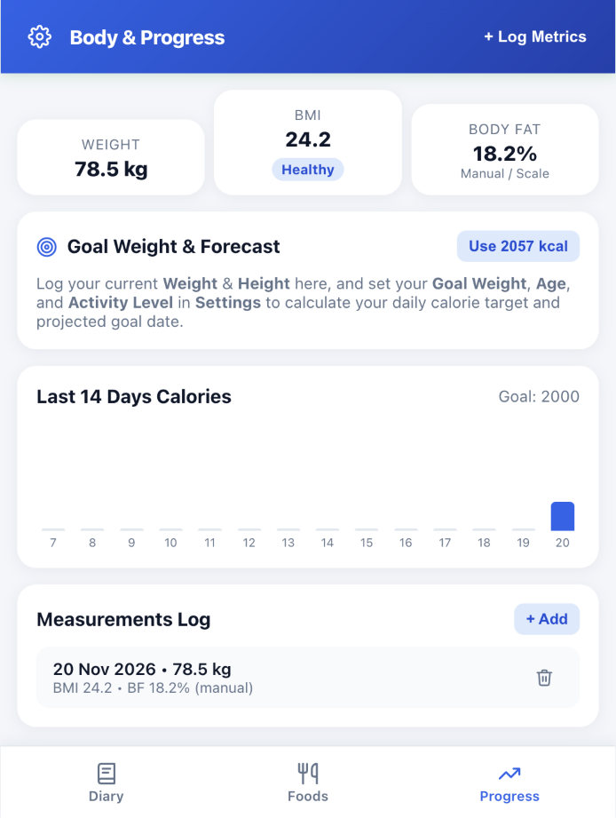
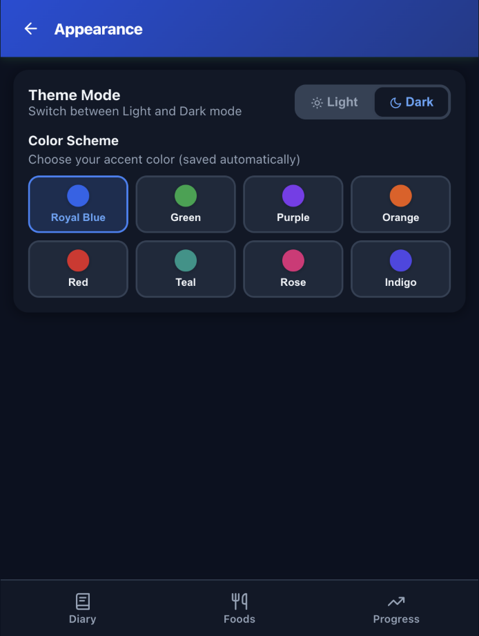

# Calorie Tracker (Blazor WebAssembly PWA)

A free, local-first, mobile-friendly calorie, nutrient, and body-metrics tracker built with **.NET 10 Blazor WebAssembly (PWA)** and **local SQLite**.

**Live App (GitHub Pages):** https://mattkaydev.github.io/calorie_counter_net_blazor/

## Screenshots

| Calorie Diary | Body & Progress | Settings | Dark Mode & Themes |
| :---: | :---: | :---: | :---: |
|  |  |  |  |

## Features
- **Daily Calorie & Nutrient Diary:** Track calories, protein, carbs, fat, saturated fat, sugars, fibre, and salt with a daily calorie ring, macro progress bars, quick-log floating `+` button, in-place entry editing, and 1-tap **Copy Yesterday**.
- **Full History Calendar:** Jump to any past day or month to review daily calorie totals and logged foods.
- **Custom Meal Times:** Start with Breakfast, Lunch, Dinner, and Snacks — add, reorder, or archive custom meal slots anytime.
- **Daily Water Tracker:** Log water intake in ml with quick `-250`, `+250ml`, and `+500` buttons against your daily hydration target.
- **Local-First Food Search & Barcode Scanner:**
  - Live camera barcode scanning (with manual barcode entry fallback).
  - Searches your local SQLite food library immediately while enriching results from **Open Food Facts** and **USDA FoodData Central**, automatically caching all returned foods locally so your database grows over time.
  - Create custom foods (per 100g) and multi-ingredient reusable Saved Meals.
- **Body Metrics, BMI, Body Fat % & Goal Weight Forecast:**
  - Track weight, height, and tape measurements (neck, waist, hip) with automatic **BMI** and **US Navy Body Fat %** calculations (plus optional manual smart-scale Body Fat % entry).
  - Estimates **BMR**, **TDEE**, recommended daily calories, and projected goal weight dates based on both your planned target and actual tracked average, alongside weight trend and 14-day calorie charts.
- **Appearance & Units:** Light & Dark mode, **8 accent colour schemes** (Royal Blue default, Green, Purple, Orange, Red, Teal, Rose, Indigo), and Metric / UK Imperial / US Imperial unit switching (stored canonically in metric).
- **Privacy-First Split SQLite Storage:**
  - `personal.sqlite` keeps all diary logs, body measurements, water logs, saved meals, and goals strictly private on-device.
  - `foods.sqlite` stores only the shareable food catalog with zero personal data.
  - Both databases support 1-click export and restore in **Settings → Backups**.
- **PWA Updates:** Automatic **"Update ready"** in-app notifications plus **Settings → Updates** to check for and apply newer versions in one tap.

## Architecture
- `src/CalorieTracker.Domain` — Pure C# models, repository interfaces, unit conversions, BMI / Body Fat % / Goal Weight math.
- `src/CalorieTracker.Data.Sqlite` — Split SQLite repositories (`personal.sqlite` & `foods.sqlite`) behind `IPersonalSqliteEngine` / `IFoodsSqliteEngine`.
- `src/CalorieTracker.Services` — Open Food Facts + USDA FoodData Central client, local-first `FoodLookupService`, `DiaryService`, and platform interfaces.
- `src/CalorieTracker.UI` — Shared Razor Class Library (ready to reuse in a future **.NET MAUI Blazor Hybrid** native mobile app).
- `src/CalorieTracker.Web` — Thin Blazor WebAssembly PWA host (`sql.js` + IndexedDB persistence, `html5-qrcode` camera scanner, `.htaccess` for Hostinger, GitHub Pages CI workflow).
- `tests/CalorieTracker.Tests` — Unit & in-memory SQLite integration tests.

## Running Locally
```bash
dotnet run --project src/CalorieTracker.Web
```
Or with live reload:
```bash
dotnet watch --project src/CalorieTracker.Web
```

## Running Tests
```bash
dotnet test
```

## Deploying to Static Hosting (Hostinger / GitHub Pages)
- **GitHub Pages:** Automatically built, tested, and deployed on every push to `main` via `.github/workflows/deploy-pages.yml`.
- **Hostinger / Static Web Host:**
  ```bash
  dotnet publish src/CalorieTracker.Web -c Release -o publish
  ```
  Upload the contents of `publish/wwwroot/` (including `.htaccess`) to `public_html`.
