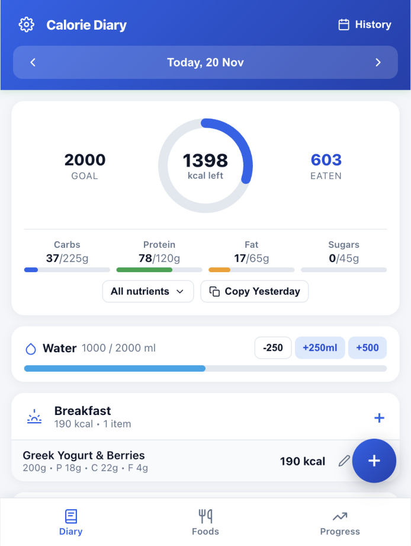
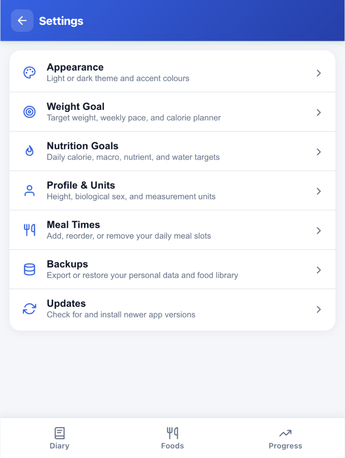

# Calorie Tracker (Blazor WebAssembly PWA)

A free, local-first, mobile-friendly calorie, nutrient, and body-metrics tracker built with **.NET 10 Blazor WebAssembly (PWA)** and **local SQLite**.

**Live App (GitHub Pages):** https://mattkaydev.github.io/calorie_counter_net_blazor/

## Screenshots

### Calorie Diary


### Body & Progress


### Settings


### Dark Mode & Themes


## Features
- **Daily Calorie & Nutrient Diary:** Track calories, protein, carbs, fat, saturated fat, sugars, fibre, and salt with **Standard**, **Compact** (collapsible nutrients), or **Minimal** summary styles, a **Fixed / Scrollable** summary toggle, serving counts displayed on every logged item, **Edit & Duplicate** across meal times and dates (with servings multiplier), and 1-tap **Copy Yesterday**.
- **Full History Calendar:** Jump to any past day or month to review daily calorie totals and logged foods.
- **Custom Meal Times & Optional Water Tracker:** Start with Breakfast, Lunch, Dinner, and Snacks — add, edit (with a flat icon picker), reorder, or archive meal slots, plus an optional, reorderable daily **Water Tracker** (`-250`, `+250ml`, `+500` quick buttons).
- **Local-First Food Search, Barcode Scanner & Food Library:**
  - Live camera barcode scanning (with manual barcode entry fallback).
  - Searches your local SQLite food library immediately (with a live loading spinner) while enriching results from **Open Food Facts** and **USDA FoodData Central**, caching returned foods locally.
  - Remembers your recent custom portions per food, supports **`g` / `ml`** measurement units, includes a **Servings** multiplier (`1x`, `2x`, or custom) when logging or editing, lets you create and edit custom foods without duplication, and organizes foods under **All Foods**, **Custom**, and **Meals** tabs.
- **Body Metrics, BMI, Body Fat % & Goal Weight Forecast:**
  - Track weight, height, and tape measurements (neck, waist, hip) with automatic **BMI** and **US Navy Body Fat %** calculations (plus optional manual smart-scale Body Fat % entry).
  - Smooth **Weight Goal** onboarding with live recommended daily calories and goal date projections as you type, plus weight trend and 14-day calorie charts.
- **Appearance, Navigation & Units:** Light & Dark mode, **8 accent colour schemes** (Royal Blue default, Green, Purple, Orange, Red, Teal, Rose, Indigo), Metric / UK Imperial / US Imperial unit switching, and a toggle to show or hide **Foods** in the bottom navigation bar (always accessible from Settings).
- **Privacy-First Split SQLite Storage:**
  - `personal.sqlite` keeps all diary logs, body measurements, water logs, saved meals, and goals strictly private on-device.
  - `foods.sqlite` stores only the shareable food catalog with zero personal data.
  - Live database storage sizes plus 1-click export and restore for both databases in **Settings → Backups**.
- **PWA Updates & Versioning:** Automatic **"Update ready"** in-app notifications plus **Settings → App Updates** showing the current 4-part version and 1-tap update & reload.

## Architecture
- `src/CalorieTracker.Domain` — Pure C# models, repository interfaces, unit conversions, BMI / Body Fat % / Goal Weight math.
- `src/CalorieTracker.Data.Sqlite` — Split SQLite repositories (`personal.sqlite` & `foods.sqlite`) behind `IPersonalSqliteEngine` / `IFoodsSqliteEngine`.
- `src/CalorieTracker.Services` — Open Food Facts + USDA FoodData Central client, local-first `FoodLookupService`, `DiaryService`, and platform interfaces.
- `src/CalorieTracker.UI` — Shared Razor Class Library (ready to reuse in a future **.NET MAUI Blazor Hybrid** native mobile app).
- `src/CalorieTracker.Web` — Thin Blazor WebAssembly PWA host (`sql.js` + IndexedDB persistence, `html5-qrcode` camera scanner, `.htaccess` for Hostinger, GitHub Pages CI workflow).
- `tests/CalorieTracker.Tests` — Unit & in-memory SQLite integration tests.

## Running Locally
```bash
dotnet run --project src/CalorieTracker.Web
```
Or with live reload:
```bash
dotnet watch --project src/CalorieTracker.Web
```

## Running Tests
```bash
dotnet test
```

## Deploying to Static Hosting (Hostinger / GitHub Pages)
- **GitHub Pages:** Automatically built, tested, and deployed on every push to `main` via `.github/workflows/deploy-pages.yml`.
- **Hostinger / Static Web Host:**
  ```bash
  dotnet publish src/CalorieTracker.Web -c Release -o publish
  ```
  Upload the contents of `publish/wwwroot/` (including `.htaccess`) to `public_html`.
